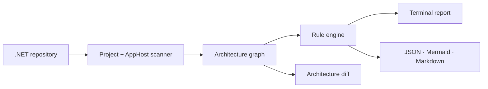

# ArchPulse

> Terminal-first architecture governance for C#.

[](https://github.com/vinycalves/archpulse/actions/workflows/ci.yml)
[](LICENSE)
[](https://dotnet.microsoft.com/)

ArchPulse is an **ArchUnit-style CLI for C#**. It scans a .NET repository, builds the project/package/Aspire dependency graph, enforces architecture rules, and fails CI when boundaries break.

No server. No database. No browser. Just a command in your terminal and a clear exit code.

```text
$ archpulse scan samples/ContosoShop
──────────────────────── ArchPulse samples/ContosoShop ─────────────────────────
╭──────────────┬───────╮
│ Metric       │ Value │
├──────────────┼───────┤
│ Components   │     9 │
│ Dependencies │    14 │
│ Services     │     2 │
│ Violations   │     1 │
│ Errors       │     1 │
│ Warnings     │     0 │
│ Cycles       │     0 │
╰──────────────┴───────╯
Components
├── Domain
│   └── ContosoShop.Domain (Library)
├── Infrastructure
│   └── ContosoShop.Infrastructure (Library)
├── Orchestration
│   └── ContosoShop.AppHost (AppHost)
├── Presentation
│   └── ContosoShop.Api (WebApp)
└── Runtime
    └── ContosoShop.Worker (Worker)
╭───────┬──────────┬───────────────────────────────────────────────────────────╮
│ Rule  │ Severity │ Finding                                                   │
├───────┼──────────┼───────────────────────────────────────────────────────────┤
│ AP002 │ Error    │ Layer dependency violation                                │
│       │          │ ContosoShop.Domain (Domain) must not depend on            │
│       │          │ ContosoShop.Infrastructure (Infrastructure).              │
╰───────┴──────────┴───────────────────────────────────────────────────────────╯
```

## Why

Architecture rules usually live in a wiki, a slide deck, or a senior engineer's head. They are checked by review, if at all. ArchPulse turns those rules into a command that runs on every commit and every pull request.

It is deliberately **C#-specific**:

- Reads `.csproj` files directly — no MSBuild execution.
- Understands `ProjectReference`, `PackageReference`, SDK style, output type, test projects, and `TargetFramework`.
- Reads Aspire AppHost declarations (`AddProject`, `AddPostgres`, `AddRedis`, `WithReference`, and friends).
- Classifies projects into domain, application, infrastructure, presentation, runtime, orchestration, and external.
- Detects project cycles, layer violations, test references, AppHost references, persistence leaks, and target-framework drift.

## Install and run

Requires the [.NET 10 SDK](https://dotnet.microsoft.com/download).

```bash
git clone https://github.com/vinycalves/archpulse.git
cd archpulse

# Run from source
dotnet run --project src/ArchPulse.Cli -- scan .

# Or publish a local binary
dotnet publish src/ArchPulse.Cli -c Release -o tools/archpulse
./tools/archpulse scan .

# Or pack and install it as a local .NET tool
dotnet pack src/ArchPulse.Cli -c Release -o artifacts/packages
dotnet tool install --global ArchPulse.Cli --add-source artifacts/packages
archpulse --version
```

The package is not yet on NuGet.org; that is on the roadmap.

## Commands

| Command | What it does |
|---|---|
| `archpulse scan [path]` | Full terminal report: summary, component tree, findings, artifacts. |
| `archpulse check [path]` | Compact CI-friendly check with an exit code. |
| `archpulse graph [path]` | Dependency tree, Mermaid, or JSON. |
| `archpulse diff <before> <after>` | Architecture delta between two scans. |
| `archpulse init [path]` | Create a starter `.archpulse/rules.json`. |
| `archpulse rules` | List the built-in rules. |
| `archpulse explain <rule>` | Explain a rule and why it matters. |
| `archpulse watch [path]` | Re-run the check when C# files or projects change. |

### Scan

```bash
archpulse scan .
archpulse scan samples/ContosoShop --details
archpulse scan . --format json
archpulse scan . --format mermaid
archpulse scan . --output artifacts/archpulse
archpulse scan . --fail-on error
```

### Check (CI)

```bash
archpulse check .
archpulse check . --fail-on warning
archpulse check . --json
```

`check` exits with:

- `0` when no violation meets the threshold.
- `1` when the threshold is met.
- `2` on a scanner or configuration error.

### Graph

```bash
archpulse graph .
archpulse graph . --depth 2
archpulse graph . --all
archpulse graph . --format mermaid
```

### Diff

```bash
archpulse scan . --output artifacts/before
# change the code
archpulse scan . --output artifacts/after

archpulse diff artifacts/before/architecture.json artifacts/after/architecture.json
archpulse diff before.json after.json --fail-on-new
```

### Init, rules, and explain

```bash
archpulse init .
archpulse rules
archpulse explain AP002
```

### Watch

```bash
archpulse watch .
```

## Rules

| Rule | Severity | What it catches |
|---|---|---|
| `AP000` | Info | No `.csproj` files found under the path. |
| `AP001` | Error | Project reference cycle. |
| `AP002` | Error | Domain or application depending on infrastructure, presentation, runtime, or orchestration. |
| `AP003` | Error | A production project referencing a test project. |
| `AP004` | Error | A service referencing the Aspire AppHost. |
| `AP006` | Warning | Persistence packages inside a domain project. |
| `AP007` | Warning | A project targeting a different framework than the solution majority. |
| `AP100` | Configurable | Repository-specific forbidden dependency. |

Custom rules live in `.archpulse/rules.json`:

```json
{
  "forbiddenDependencies": [
    {
      "id": "SHOP-001",
      "from": "Shop.Api",
      "to": "Shop.Domain",
      "severity": "Warning",
      "title": "API must not depend directly on the domain",
      "message": "Use the Shop.Application layer instead."
    }
  ]
}
```

`from` and `to` support `*` and `?` wildcards. See [docs/rules.md](docs/rules.md).

## CI

```yaml
name: Architecture

on: [push, pull_request]

jobs:
  archpulse:
    runs-on: ubuntu-latest
    steps:
      - uses: actions/checkout@v4
      - uses: actions/setup-dotnet@v4
        with:
          dotnet-version: 10.0.x
      - run: dotnet run --project src/ArchPulse.Cli -- check . --fail-on error
```

The repository also ships an [architecture-diff workflow](.github/workflows/archpulse.yml) that comments the delta on pull requests.

## How it works



- **`ArchPulse.Core`** — project discovery, AppHost parser, graph builder, rule engine, renderers, diff, rule catalog.
- **`ArchPulse.Cli`** — Spectre.Console commands, terminal renderer, settings, exit codes.
- **`ArchPulse.Core.Tests`** — unit tests for the scanner, rules, renderers, and diff.

See [docs/architecture.md](docs/architecture.md) for the full architecture and [docs/adr](docs/adr) for the decisions.

## Roadmap

- **v0.2 — CLI-first (now):** terminal reports, check, graph, diff, init, rules, explain, watch, AP007.
- **v0.3:** Roslyn namespace-level dependency rules, `.archpulseignore`, SARIF output, NuGet global tool.
- **v0.4:** interactive `archpulse explore` TUI, graph filters, architecture diff baseline cache.
- **v1.0:** stable JSON schema, GitHub Action, plugin analyzers for other .NET project types, community rule packs.

See [docs/roadmap.md](docs/roadmap.md).

## Contributing

Contributions are welcome — especially new rules, terminal UX improvements, Roslyn analyzers, and sample repositories. Read [CONTRIBUTING.md](CONTRIBUTING.md) and [CODE_OF_CONDUCT.md](CODE_OF_CONDUCT.md). Start with the [good-first issues](https://github.com/vinycalves/archpulse/issues?q=is%3Aissue+is%3Aopen+label%3A%22good+first+issue%22).

## License

MIT. See [LICENSE](LICENSE).
