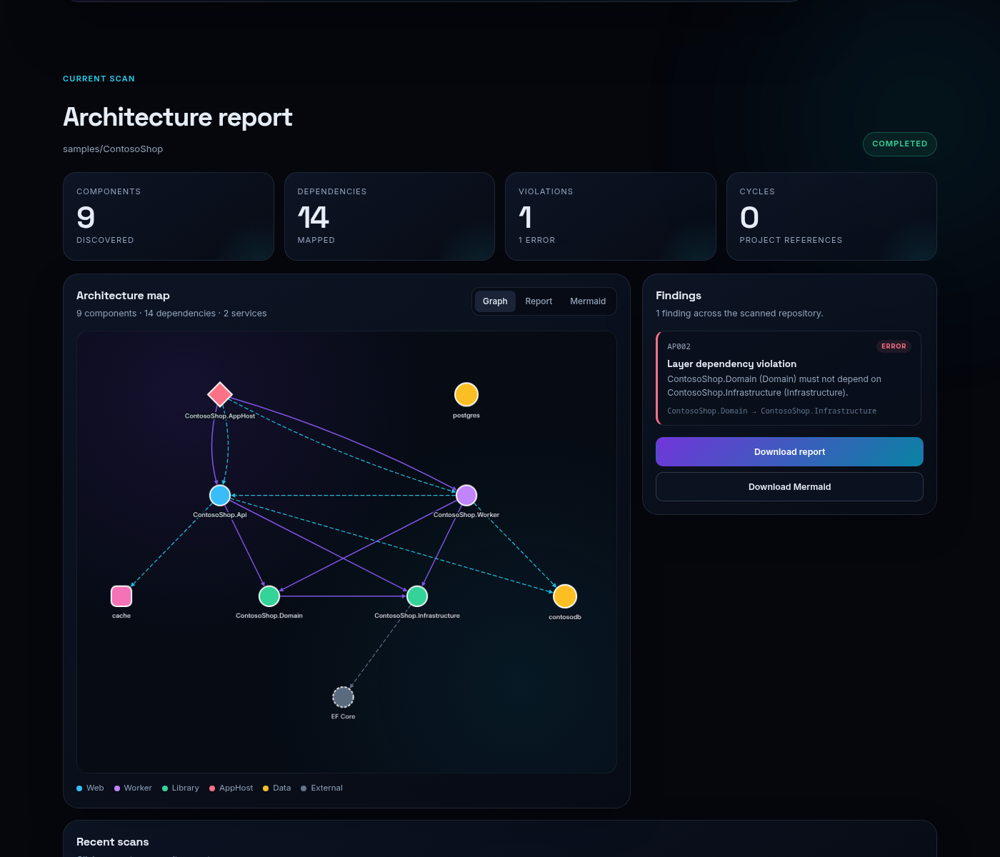
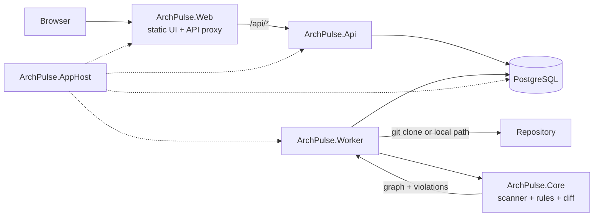

# ArchPulse

> Living architecture for .NET and Aspire applications.

[](https://github.com/vinycalves/archpulse/actions/workflows/ci.yml)
[](LICENSE)
[](https://dotnet.microsoft.com/)
[](https://learn.microsoft.com/dotnet/aspire/)

ArchPulse scans a .NET repository, discovers its projects and Aspire resources, renders a living architecture graph, and evaluates rules that keep boundaries honest. It is built to run locally, in CI, and as an architecture diff on every pull request.

**Status:** early alpha (`v0.1`). The scanner, CLI, API, worker, and dashboard work end to end. The roadmap is below.



## Why ArchPulse?

Architecture docs rot. Diagrams are drawn once and never updated. ArchPulse derives the model from the repository itself — project references, package dependencies, and Aspire `AppHost` declarations — so the map can be regenerated on every commit and reviewed on every pull request.

It is not a diagram editor. It is a feedback loop for architectural drift.

## What it does

- Discovers `.csproj` projects and `ProjectReference` edges without running MSBuild.
- Reads Aspire AppHost source for `AddProject`, `AddPostgres`, `AddRedis`, `AddRabbitMQ`, `AddDatabase`, and `WithReference`.
- Classifies components into domain, application, infrastructure, presentation, runtime, orchestration, and external.
- Evaluates built-in rules: cycles, layer violations, test references, AppHost references, and persistence in the domain.
- Supports repository-specific forbidden dependencies in `.archpulse/rules.json`.
- Renders a Mermaid diagram, a Markdown report, and a JSON graph.
- Compares two scans and reports added/removed components, dependencies, and violations.
- Runs as an Aspire application with a web dashboard, API, background worker, and PostgreSQL.
- Includes a CLI for local use and CI.

## Quickstart

**Prerequisites:** [.NET 10 SDK](https://dotnet.microsoft.com/download) and Docker (for the Aspire PostgreSQL resource).

```bash
git clone https://github.com/vinycalves/archpulse.git
cd archpulse
dotnet run --project src/ArchPulse.AppHost
```

Open the Aspire dashboard, then the `archpulse-web` endpoint. Click **Try the demo** to scan `samples/ContosoShop`, a tiny Aspire app with an intentional `AP002` layer violation.

### CLI

```bash
# Scan the sample
dotnet run --project src/ArchPulse.Cli -- scan samples/ContosoShop --output artifacts/contoso

# Guard your own repository in CI
dotnet run --project src/ArchPulse.Cli -- scan . --fail-on error

# Compare two scans
dotnet run --project src/ArchPulse.Cli -- diff before/architecture.json after/architecture.json --fail-on-new
```

The CLI writes `architecture.json`, `architecture.mmd`, and `report.md` to the output directory.

## Architecture



| Project | Responsibility |
|---|---|
| `ArchPulse.Core` | Domain model, project discovery, Aspire parser, graph builder, rules, renderers, diff. No infrastructure dependencies. |
| `ArchPulse.Infrastructure` | EF Core persistence, local/GitHub source resolvers, scan runner, DI. |
| `ArchPulse.Api` | HTTP endpoints: create/list/get scans, reports, diagrams, diffs. |
| `ArchPulse.Worker` | Claims queued scans and runs them in the background. |
| `ArchPulse.Web` | Static dashboard and same-origin `/api` proxy using Aspire service discovery. |
| `ArchPulse.AppHost` | Aspire orchestration for PostgreSQL, API, worker, and web. |
| `ArchPulse.Cli` | Local and CI entry point for `scan` and `diff`. |

## Rules

| Rule | Severity | What it catches |
|---|---|---|
| `AP000` | Info | No `.csproj` files found. |
| `AP001` | Error | Project reference cycle. |
| `AP002` | Error | Domain or application depending on infrastructure, presentation, runtime, or orchestration. |
| `AP003` | Error | A production project referencing a test project. |
| `AP004` | Error | A service referencing the Aspire AppHost. |
| `AP006` | Warning | Persistence packages inside a domain project. |
| `AP100` | Configurable | Repository-specific forbidden dependency. |

Custom rules:

```json
{
  "forbiddenDependencies": [
    {
      "id": "SHOP-001",
      "from": "Shop.Api",
      "to": "Shop.Domain",
      "severity": "Warning",
      "title": "API must not depend directly on the domain",
      "message": "Use the application layer instead."
    }
  ]
}
```

`from` and `to` support `*` and `?` wildcards. See [docs/rules.md](docs/rules.md).

## OpenTelemetry and Aspire

The API, worker, and web projects share `ServiceDefaults`: health checks, service discovery, resilient HTTP clients, and OpenTelemetry traces/metrics/logs. In development, the Aspire dashboard is the observability cockpit. The architecture model is intentionally separate from runtime telemetry; the next milestone is overlaying traces and latency onto the graph.

## Roadmap

- **v0.1 — now:** scanner, CLI, API/worker, graph UI, built-in rules, Aspire orchestration.
- **v0.2:** OpenTelemetry runtime overlay, GitHub App/PR comments, rule packs, `.archpulseignore`.
- **v0.3:** plugin analyzers (Java/Node/Python), C4 export, drift history, hosted demo.
- **v1.0:** stable JSON schema, auth/multi-tenant, deployment guides, community governance.

See [docs/roadmap.md](docs/roadmap.md) for the details.

## Contributing

Contributions are welcome — especially new rules, renderers, sample repositories, and UI polish. Read [CONTRIBUTING.md](CONTRIBUTING.md) and [CODE_OF_CONDUCT.md](CODE_OF_CONDUCT.md). Look for issues labeled `good first issue`, or start with the [seeded roadmap issues](https://github.com/vinycalves/archpulse/issues?q=is%3Aissue+is%3Aopen+label%3A%22good+first+issue%22).

## License

MIT. See [LICENSE](LICENSE).
