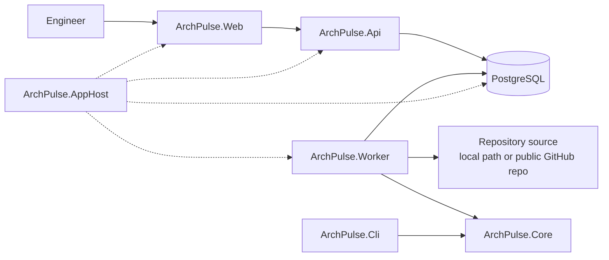
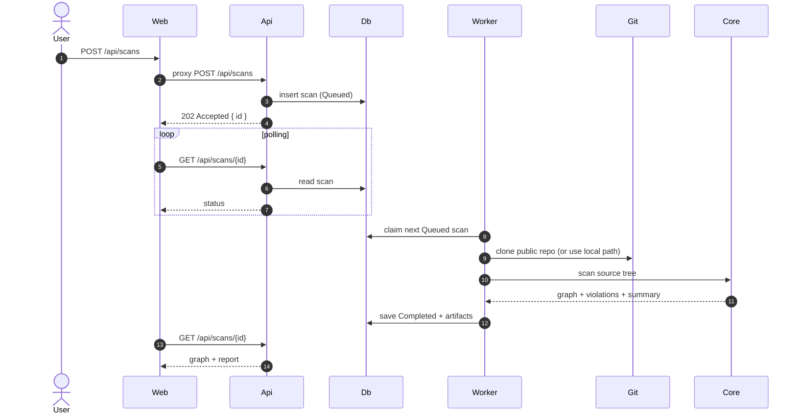

# Architecture

## Context

ArchPulse is a small distributed system built with .NET 10 and Aspire. The AppHost orchestrates four resources in development: PostgreSQL, the API, the worker, and the web frontend. The CLI uses the same core scanner without the web stack.

## Containers

### ArchPulse.Core

The pure core. It has no EF Core, HTTP, or Aspire hosting dependencies.

- `ProjectDiscovery` finds `.csproj` files and parses references/packages.
- `AppHostDiscovery` extracts Aspire resources and `WithReference` edges.
- `ArchitectureGraphBuilder` merges both sources into one graph.
- `ArchitectureRuleEngine` evaluates built-in and custom rules.
- `MermaidRenderer`, `MarkdownReportRenderer`, and the diff renderers produce review artifacts.

### ArchPulse.Infrastructure

- `ArchPulseDbContext` persists scan jobs and results.
- `ScanRepository` implements the job queue and result storage.
- `LocalPathSourceResolver` and `GitHubSourceResolver` resolve scan sources.
- `ScanRunner` composes source resolution and the core scanner.
- `DatabaseInitializer` retries schema creation while PostgreSQL starts.

### ArchPulse.Api

Minimal API endpoints:

| Method | Route | Purpose |
|---|---|---|
| `GET` | `/api/scans` | List recent scans. |
| `POST` | `/api/scans` | Queue a scan (`path` or `github`). |
| `POST` | `/api/scans/demo` | Queue the bundled ContosoShop sample. |
| `GET` | `/api/scans/{id}` | Get status, graph, violations, report, and Mermaid. |
| `GET` | `/api/scans/{id}/diagram` | Download the Mermaid diagram. |
| `GET` | `/api/scans/{id}/report` | Download the Markdown report. |
| `GET` | `/api/scans/{id}/diff/{baselineId}` | Compare two completed scans. |
| `DELETE` | `/api/scans/{id}` | Delete a scan. |
| `GET` | `/api/meta` | Service metadata. |

### ArchPulse.Worker

Polls for queued scans, claims one inside a transaction, resolves the source, runs the scanner, and stores the result. A failed scan is persisted with its error instead of crashing the worker.

### ArchPulse.Web

Serves the static dashboard and proxies `/api/*` to the API through an `HttpClient` configured with Aspire service discovery. This keeps the browser same-origin and avoids CORS configuration.

### ArchPulse.Cli

`scan` writes JSON, Mermaid, and Markdown. `diff` compares two scans and can fail CI when new errors are introduced.

## Scan flow

## Domain model

- **ArchitectureComponent**: id, name, kind, layer, project path, metadata.
- **ArchitectureDependency**: from, to, kind (`ProjectReference`, `PackageReference`, `AspireReference`, `Http`), evidence.
- **ArchitectureViolation**: rule id, severity, title, message, from, to.
- **ArchitectureSummary**: component/dependency/service/violation/cycle counts.
- **ScanOutcome**: graph + violations + summary.
- **ScanJob**: persisted queue state and serialized artifacts.

## Persistence

One table, `scans`:

| Column | Notes |
|---|---|
| `Id` | UUID primary key. |
| `SourceType` / `SourceValue` | `path` or `github`, plus the source. |
| `Status` | `Queued`, `Running`, `Completed`, `Failed`. |
| `CreatedAt` / `StartedAt` / `CompletedAt` | UTC timestamps. |
| `Error` | Last failure message. |
| `GraphJson` / `ViolationsJson` / `SummaryJson` | Serialized result. |
| `Mermaid` / `ReportMarkdown` | Pre-rendered artifacts. |

The schema is created with `EnsureCreatedAsync` in v0.1. Migrations are a v0.2 task.

## Failure modes

| Failure | Behavior |
|---|---|
| PostgreSQL not ready | API/worker retry initialization, then fail fast. |
| Invalid local path | Scan fails with a clear error; job is marked `Failed`. |
| Path outside allowed roots | Rejected by `LocalPathSourceResolver`. |
| Git clone timeout | Process is killed; temp directory is removed; scan fails. |
| Unsupported source | Validation error before a job is created. |
| Worker crash | Job remains `Running`; a v0.2 lease/recovery job will requeue stale scans. |
| Malformed rules file | Scan fails with the file path and parse error. |

## Security

- Local path scans are restricted to `Scanner:AllowedRoots`.
- Repository scans accept only public `https://github.com/{owner}/{repo}` URLs.
- ArchPulse does not build or execute the target repository.
- Git clones use `--depth 1`, a timeout, and a temp directory removed after the scan.
- The API has no authentication in v0.1; deploy it behind an authenticated proxy before exposing it publicly.

## Observability

`ServiceDefaults` configures OpenTelemetry for ASP.NET Core, HTTP clients, and the runtime. The Aspire dashboard receives traces, metrics, and logs in development. Health endpoints are exposed by `MapDefaultEndpoints` in development.

## Decisions

- [ADR 0001: Record architecture decisions](adr/0001-record-architecture-decisions.md)
- [ADR 0002: Modular monolith plus background worker](adr/0002-modular-monolith-and-worker.md)
- [ADR 0003: Aspire for local orchestration](adr/0003-aspire-for-local-orchestration.md)
- [ADR 0004: Pragmatic source analysis](adr/0004-pragmatic-source-analysis.md)
- [ADR 0005: PostgreSQL with SQLite fallback](adr/0005-postgresql-with-sqlite-fallback.md)
- [ADR 0006: Static web UI with API proxy](adr/0006-static-web-ui-with-api-proxy.md)
