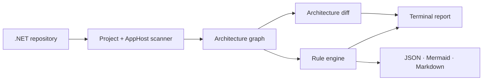
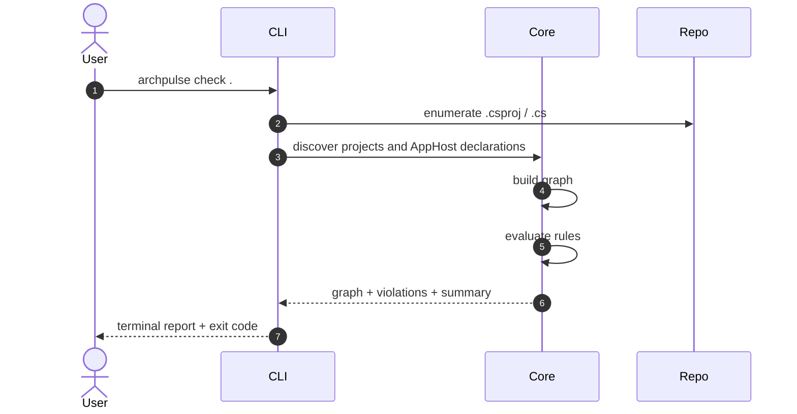

# Architecture

## Overview

ArchPulse is a single .NET CLI process. It reads a repository, builds an architecture graph, evaluates rules, and writes to the terminal or to files.

There is no API, worker, database, or web frontend.

## Modules

### ArchPulse.Core

The pure analysis library. It has no CLI or hosting dependencies.

- `ProjectDiscovery` finds `.csproj` files and parses SDK, output type, `ProjectReference`, `PackageReference`, `TargetFramework`, and test metadata.
- `AppHostDiscovery` extracts Aspire resources and `WithReference` edges from AppHost source.
- `ArchitectureGraphBuilder` merges both sources into one graph with component kinds and layers.
- `ArchitectureRuleEngine` evaluates built-in and custom rules.
- `RuleCatalog` is the single source of truth for rule IDs, titles, severities, and rationale.
- `MermaidRenderer`, `MarkdownReportRenderer`, and the diff renderers produce review artifacts.

### ArchPulse.Cli

The terminal product, built with Spectre.Console.Cli.

- `scan` — full report: summary, component tree, findings, optional artifacts.
- `check` — compact report with a CI-friendly exit code.
- `graph` — dependency tree, Mermaid, or JSON.
- `diff` — terminal, Markdown, or JSON architecture delta.
- `init` — starter `.archpulse/rules.json`.
- `rules` / `explain` — rule discovery and rationale.
- `watch` — rerun checks when C# files, projects, or rules change.

Commands return `0` for success, `1` when a configured threshold is met, and `2` for scanner or configuration errors.

### ArchPulse.Core.Tests

Unit tests for project discovery, AppHost parsing, graph building, rules, rendering, and diff.

## Scan pipeline

1. Resolve the path. A file path uses its containing directory.
2. Discover projects, excluding `bin`, `obj`, `.git`, `node_modules`, `artifacts`, and `samples`.
3. Parse project references, package references, SDK, output type, TFM, and test metadata.
4. Parse Aspire AppHost files for resources and references.
5. Build the graph: components, dependencies, layers, external packages, and resources.
6. Load `.archpulse/rules.json` when present.
7. Evaluate built-in and custom rules.
8. Render terminal output and/or artifacts, then return the exit code.

## Graph model

- **ArchitectureComponent**: id, name, kind, layer, project path, metadata.
- **ArchitectureDependency**: from, to, kind (`ProjectReference`, `PackageReference`, `AspireReference`, `Http`), evidence.
- **ArchitectureViolation**: rule id, severity, title, message, from, to.
- **ArchitectureSummary**: component/dependency/service/violation/cycle counts.
- **ScanOutcome**: graph + violations + summary.

Component kinds: `WebApp`, `Worker`, `Library`, `AppHost`, `Test`, `Service`, `Database`, `Cache`, `Broker`, `External`.

Layers: `Domain`, `Application`, `Infrastructure`, `Presentation`, `Runtime`, `Orchestration`, `Tests`, `Shared`, `External`.

## Rules

The built-in rules are documented in [rules.md](rules.md). Custom rules live in `.archpulse/rules.json` and support `*` and `?` wildcards.

## Output formats

| Format | Use |
|---|---|
| Terminal | Human-friendly report with tables, trees, and colors. |
| JSON | CI, automation, and diff input. |
| Mermaid | Documentation and pull request diagrams. |
| Markdown | Review comments and architecture reports. |

## Failure modes

| Failure | Behavior |
|---|---|
| Invalid path | Validation error with exit code 2. |
| No `.csproj` files | Info finding `AP000`; the scan still completes. |
| Malformed `.csproj` | Scan fails with the project path and parse error. |
| Malformed rules file | Scan fails with the file path and parse error. |
| Unsupported source | Not applicable: the CLI scans local paths only. |
| Watch mode change storm | Debounced by a 250 ms delay and a pending flag. |

## Security

- The CLI scans local paths only.
- It does not build, restore, or execute the target repository.
- It does not require network access.
- XML parsing uses `XDocument.Load` with the runtime's default DTD prohibition.
- Reports may contain repository names, paths, and package names; review them before publishing.

## Decisions

- [ADR 0001: Record architecture decisions](adr/0001-record-architecture-decisions.md)
- [ADR 0004: Pragmatic source analysis](adr/0004-pragmatic-source-analysis.md)
- [ADR 0007: Terminal-first CLI architecture](adr/0007-terminal-first-cli.md)
- [ADR 0008: Spectre.Console for terminal UX](adr/0008-spectre-console.md)
